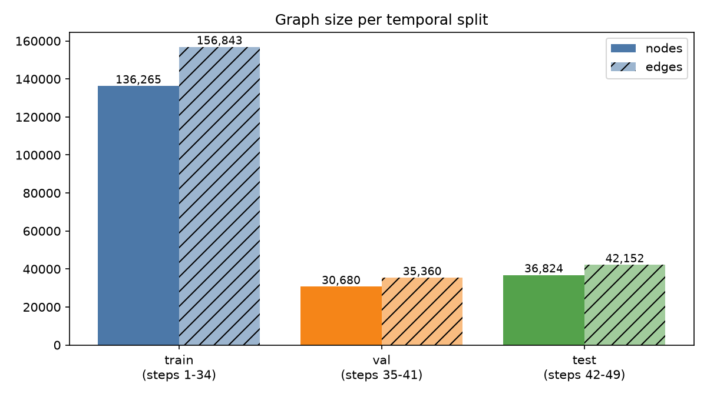
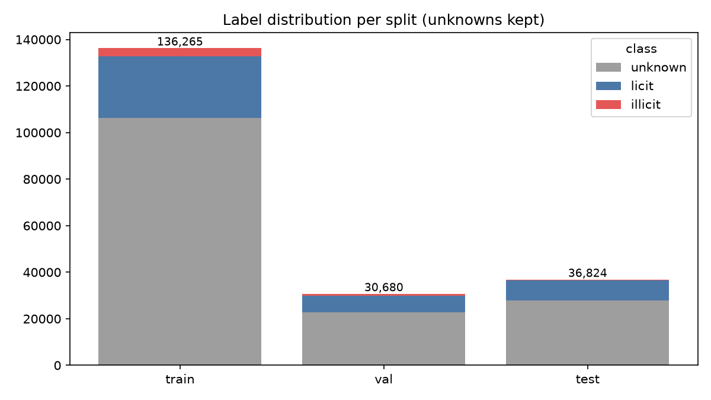
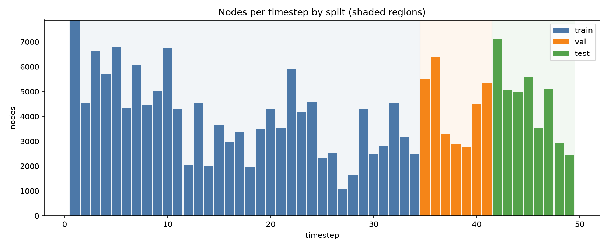
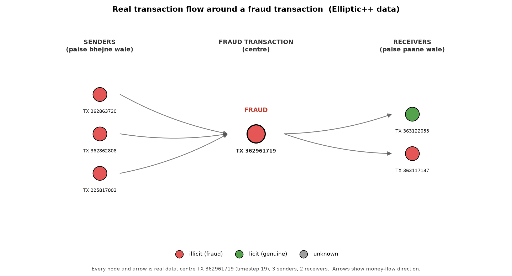
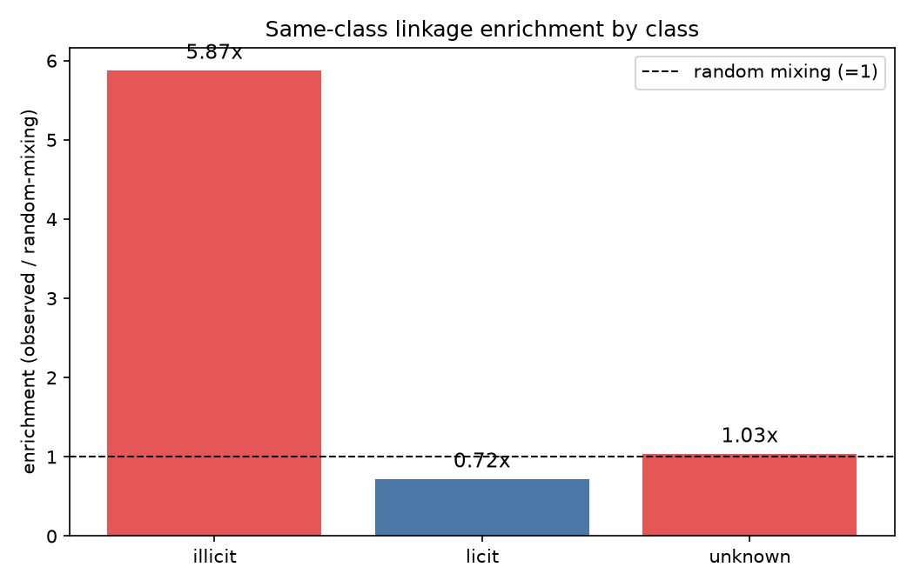
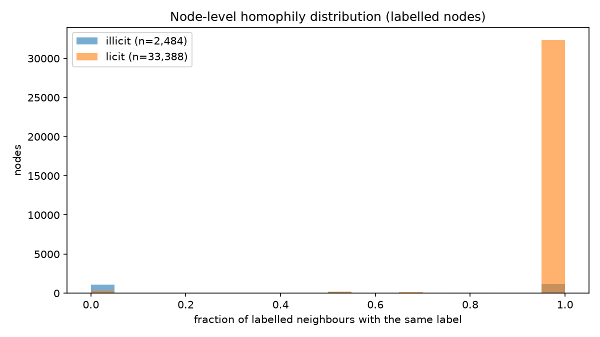
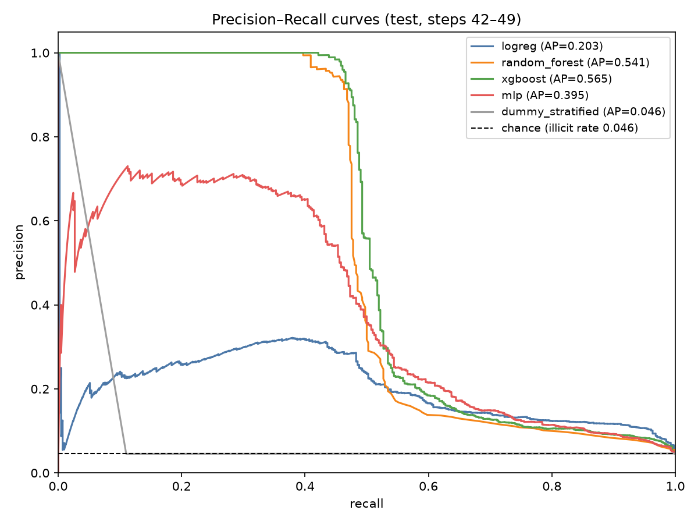

# Homophily-Aware GNN for Financial Fraud Ring Detection

Detecting **fraud rings** in Bitcoin transaction networks using **homophily-aware
Graph Neural Networks**, built on the
[Elliptic++ dataset](https://github.com/git-disl/EllipticPlusPlus) (Elmougy & Liu, KDD 2023).

## Motivation

Financial fraud rarely happens in isolation — illicit actors transact with each other,
forming dense **fraud rings**. In transaction graphs this shows up as *homophily*:
nodes of the same class (illicit / licit) tend to be connected. Standard GNNs assume
homophily implicitly, but fraud graphs are only *partially* homophilic, and blindly
smoothing over heterophilic edges hurts detection. This project:

1. Quantifies homophily in the Elliptic++ transaction graph (node/edge homophily,
   class-wise assortativity, per-timestep drift).
2. Benchmarks standard baselines (tabular ML + vanilla GNNs).
3. Designs and evaluates **homophily-aware GNN variants** that adapt message passing
   to local homophily structure.

---

## Project status — where we are

| Phase | Status | What was done |
|---|---|---|
| **Phase 1 — Setup** | ✅ Complete | Repo scaffolding, Elliptic++ dataset downloaded & verified (`scripts/verify_data.py` → PASS), one-command setup (`python start.py`), `requirements.txt`, `SETUP.md` guide |
| **Phase 2 — Exploratory Data Analysis** | ✅ Complete | Executed notebook `notebooks/01_data_exploration.ipynb` (32 cells, 0 errors), 9 figures in `results/figures/eda/`, findings in `results/eda_summary.md`, leakage audit in `results/leakage_analysis.md` |
| **Phase 3 — Step 3: Graph construction & temporal split** | ✅ Complete | Directed money-flow graph built & validated (`notebooks/02_graph_construction.ipynb`, 7 cells, 0 errors); temporal train/val/test splits defined — see below |
| **Phase 3 — Step 4: Homophily analysis** | ✅ Complete | Edge/node homophily recomputed & confirmed vs Phase 2 (h_lab 0.9537 vs baseline 0.9043); per-timestep drift; feature homophily; transductive majority-neighbour structural baseline (`notebooks/03_homophily_analysis.ipynb`, 8 cells, 0 errors) |
| **Phase 3 — Step 5: Baseline models** | ✅ Complete | LogReg / RandomForest / XGBoost / MLP / Dummy on temporal splits, class weighting only (`notebooks/04_baseline_models.ipynb`, 7 cells, 0 errors) — best: XGBoost, test PR-AUC 0.5652 |
| **Phase 3 — Step 6: GNN experiments** | ⬜ Not started | GCN / GAT / GraphSAGE → homophily-aware variants, fraud-ring evaluation (see Roadmap) |

**Headline findings from Phase 2** (all computed, none estimated):

- **Illicit→illicit linkage is 5.9× the random-mixing rate** — the core homophily
  signal this project is built to exploit. (Licit edges, by contrast, mix more
  broadly than chance at 0.72×.)
- **The graph is temporally clean**: exactly **0 cross-step edges** out of 234,355 —
  the 49 weakly connected components map 1:1 onto the 49 time steps, so temporal
  train/test splits are graph-clean by construction and message passing can never
  leak across time.
- **No label leakage**: no feature determines the label (max |correlation| with the
  illicit indicator is 0.267); 0 zero-variance features.
- **Top discriminative features** (illicit vs licit, |Cohen's d|): `Local_feature_53`
  (−1.162), `Local_feature_55` (−0.997), `Local_feature_89` (−0.990),
  `Local_feature_90` (−0.987).

Full detail: [`results/eda_summary.md`](results/eda_summary.md) ·
[`results/leakage_analysis.md`](results/leakage_analysis.md)

**Headline findings from Steps 4–5** (all computed, none estimated):

- **Homophily confirmed, with a twist:** aggregate h_lab 0.9537 is close to the
  random-mixing baseline 0.9043, but per-class conditioning tells the real
  story — illicit nodes link to illicit nodes at 5.9× chance, licit nodes mix
  more broadly than chance (0.72×). Node-level homophily is bimodal for
  illicit nodes (mean 0.51; 45% have zero same-label neighbours, 46% have
  all). No temporal drift in homophily across the 49 steps.
- **Best baseline: XGBoost — test PR-AUC 0.5652** (val 0.9344), ahead of
  Random Forest (0.5407), MLP (0.3948), LogReg (0.2025) and Dummy (0.0461).
  Every model drops sharply from val to test — future transactions are
  genuinely harder, which is exactly what the temporal split exposes.
- **Structural baseline cleared:** the transductive majority-neighbour
  reference (PR-AUC 0.3932 on covered test nodes) is beaten by every
  non-dummy model — but it peeks at neighbour labels, so it is an upper
  bound, not a fair model.

Full detail: [`results/homophily_analysis.md`](results/homophily_analysis.md) ·
[`results/baseline_summary.md`](results/baseline_summary.md)

---

## Phase 3 — Graph construction & temporal split ✅

Built the **directed transaction → transaction money-flow graph** from the raw
CSVs (read-only) and defined **temporal** train/val/test splits. Executed end to
end in `notebooks/02_graph_construction.ipynb` (7 code cells, 0 errors);
pipeline script: `scripts/build_graph.py`.

**Graph:** 203,769 nodes · 234,355 directed edges · density 5.6e-06 ·
49 weakly connected components · mean/max in-degree 1.15/284 · out-degree 1.15/472.

**Validation (all PASS):** 0 cross-step edges · 49 components map 1:1 onto the
49 timesteps · 0 self-loops · 0 isolated nodes.

**Temporal splits** — never random, so evaluation measures generalization to
future transactions. All edges are intra-timestep, so no edge crosses a split
boundary (graph-clean by construction):

| Split | Timesteps | Nodes | Edges | Illicit | Licit | Unknown |
|---|---|---|---|---|---|---|
| train | 1–34 | 136,265 | 156,843 | 3,462 | 26,432 | 106,371 |
| val | 35–41 | 30,680 | 35,360 | 675 | 7,154 | 22,851 |
| test | 42–49 | 36,824 | 42,152 | 408 | 8,433 | 27,983 |





**Real transaction flow (teacher-demo figure):** one real fraud transaction
(TX 362961719, timestep 19) with its actual neighbours — 3 fraud senders on
the left, one fraud + one genuine receiver on the right. Every node and arrow
is real Elliptic++ data, drawn by `scripts/build_flow_figure.py`:



**Artifacts:** `data/processed/node_splits.csv` (txId, timestep, split, class) ·
`data/processed/graph_splits.json` · `results/graph_stats.json` ·
[`results/graph_construction_summary.md`](results/graph_construction_summary.md)

---

## Phase 3 — Homophily analysis & baseline models ✅

### Step 4 — Homophily analysis

Recomputed and confirmed the Phase 2 homophily numbers, then went deeper.
Executed end to end in `notebooks/03_homophily_analysis.ipynb` (8 code cells,
0 errors); builder script: `scripts/build_homophily_notebook.py`.

- **Edge homophily:** h_lab **0.9537** vs random-mixing baseline **0.9043**;
  illicit→illicit enrichment **5.9×**, licit **0.72×**, unknown 1.03×.
  P(dst=illicit | src=illicit) = 0.296, P(dst=licit | src=licit) = 0.681.
- **Node homophily:** illicit nodes mean 0.51 (bimodal — 45% have zero
  same-label neighbours, 46% have all); licit nodes mean 0.98.
- **Drift:** none — h_lab slope −0.00001/step, illicit-rate slope −0.0004/step.
- **Feature homophily:** mean |standardised local-feature difference| 0.473
  across real edges vs 0.484 across random pairs (ratio 0.98) — modest.
- **Structural baseline** (majority-neighbour vote, transductive upper bound
  that peeks at neighbour labels): PR-AUC 0.3932, ROC-AUC 0.7256, F1@0.5
  0.5158 on covered test nodes (coverage 73.1%).




**Artifacts:** `results/homophily_stats.json` ·
[`results/homophily_analysis.md`](results/homophily_analysis.md) · figures in
`results/figures/homophily/`

### Step 5 — Baseline models

Non-graph baselines on the temporal splits — the bar the GNN (Step 6) has to
beat. Executed end to end in `notebooks/04_baseline_models.ipynb` (7 code
cells, 0 errors); pipeline script: `scripts/run_baselines.py`.

**Setup:** all 183 features; supervised on labelled nodes only (unknowns kept
in the dataset, no target); median imputation fit on train only + one
missingness-indicator column; StandardScaler fit on train only (LogReg/MLP
only); class weighting only — no SMOTE, no oversampling; selection on val
PR-AUC, final numbers on test.

| Model | Val PR-AUC | Test PR-AUC | Test ROC-AUC | Test F1@0.5 |
|---|---|---|---|---|
| **XGBoost** | **0.9344** | **0.5652** | 0.8542 | 0.5928 |
| Random Forest | 0.9277 | 0.5407 | 0.8346 | 0.5860 |
| MLP | 0.6404 | 0.3948 | 0.8541 | 0.3432 |
| Logistic Regression | 0.3823 | 0.2025 | 0.8571 | 0.2144 |
| Dummy (stratified) | 0.0882 | 0.0461 | 0.4991 | 0.0644 |



**Reading the results:** the val→test drop (XGBoost 0.934 → 0.565) is the
temporal gap — future transactions are genuinely harder, and a random split
would have hidden it. ROC-AUC flatters here (LogReg has the highest test
ROC-AUC, 0.8571, but the second-worst PR-AUC), which is why PR-AUC is the
primary metric. XGBoost's test PR-AUC of **0.5652** is the number Step 6
must beat.

**Artifacts:** `results/baseline_results.json` ·
[`results/baseline_summary.md`](results/baseline_summary.md) · figures in
`results/figures/baselines/`

---

## Quick start

One command sets up everything — virtualenv, dependencies, dataset download,
verification:

```bash
git clone https://github.com/gauravdev95/Homophily-Aware-GNN-Fraud-Ring-Detection.git
cd Homophily-Aware-GNN-Fraud-Ring-Detection
python start.py
```

`start.py` (stdlib only, Windows/macOS/Linux) creates `.venv/`, installs
`requirements.txt`, downloads any missing dataset files into `data/raw/elliptic_pp/`,
and runs `scripts/verify_data.py`. Full guide, manual `pip install` path, and
troubleshooting: **[SETUP.md](SETUP.md)**.

---

## Dataset — in depth

**Source:** Elliptic++ Transactions (Elmougy & Liu, KDD 2023) —
[official repo](https://github.com/git-disl/EllipticPlusPlus) ·
[paper (arXiv:2306.06108)](https://arxiv.org/abs/2306.06108).
The Actors/Wallet dataset is intentionally out of scope for this project.

| File | Shape | Content | Location |
|---|---|---|---|
| `txs_features.csv` | 203,769 × 184 | `txId` + 183 features (~694.8 MB) | [data-v1 release](https://github.com/gauravdev95/Homophily-Aware-GNN-Fraud-Ring-Detection/releases/tag/data-v1) ([direct download](https://github.com/gauravdev95/Homophily-Aware-GNN-Fraud-Ring-Detection/releases/download/data-v1/txs_features.csv), no login needed) |
| `txs_classes.csv` | 203,769 × 2 | `txId`, `class` | committed in `data/raw/elliptic_pp/` |
| `txs_edgelist.csv` | 234,355 × 2 | directed money-flow edges `txId1 → txId2` | committed in `data/raw/elliptic_pp/` |

(`txs_features.csv` exceeds GitHub's 100 MB/file limit, so it lives on the release;
the two small CSVs are versioned in git. `python start.py` fetches everything
automatically.)

### Feature taxonomy (183 features)

| Group | Count | Notes |
|---|---|---|
| `Time step` | 1 | Integer 1–49; every edge stays inside one step |
| `Local_feature_1` … `Local_feature_93` | 93 | Anonymized, standardized (≈ mean 0, std 1). Referenced by name only — meanings not interpreted, per official docs |
| `Aggregate_feature_1` … `Aggregate_feature_72` | 72 | Anonymized neighborhood aggregates, heterogeneous scales |
| Named statistics | 17 | `in/out_txs_degree`, `total_BTC`, `fees`, `size`, `num_input/output_addresses`, `in/out_BTC_min/max/mean/median/total` |

### Labels

| Class | Meaning | Count | Share |
|---|---|---|---|
| `1` | illicit | 4,545 | 2.23% |
| `2` | licit | 42,019 | 20.62% |
| `3` | unknown | 157,205 | 77.15% |

Only 22.85% of transactions are labeled (licit:illicit ≈ 9.25:1). Unknowns are
**kept** — the modeling setup is semi-supervised, not filtered. Label prior drift
over the 49 steps is negligible (+0.026).

### Graph structure

- Directed money-flow edges; 100% go forward in time (dst step ≥ src step).
- Heavy-tailed degrees: in-degree max 284, out-degree max 472 (mean 1.15).
- 49 weakly connected components ⇔ 49 time steps (exact 1:1 mapping, verified).
- 0 self-loops, 0 duplicate edges, 0 dangling endpoints, 0 isolated nodes.

---

## Data quality & cleaning

### What was verified (Phase 1 + 2)

- **ID consistency:** feature-ID set == class-ID set exactly (203,769 each); 0 duplicate `txId`s.
- **Graph integrity:** 0 self-loops, 0 duplicate edges, 0 dangling endpoints, 0 isolated nodes.
- **No leakage:** no deterministic feature→label mapping; max |r| with illicit = 0.267
  (`Aggregate_feature_57`), with licit = 0.517; 0 zero-variance
  features; cross-time leakage structurally impossible (0 cross-step edges).
- **Near-duplicates:** 10 features have a partner with |r| > 0.999 — drop one of each
  pair before modeling.

### Missing values — what exists and what to do

**What exists:** 16,405 missing cells (0.04% of all feature cells), confined to the
17 named statistical columns — the **same 965 rows are missing all 17** (a clean
co-missing block). Their labels: 0 illicit, 519 licit, 446 unknown — i.e.
missingness is disproportionately licit/unknown, never illicit.

**What we did in Phase 2:** nothing destructive — no rows dropped, no imputation,
unknowns kept. EDA is descriptive; the missing block is reported as-is
(`eda_missing_values.png`, `results/eda_summary.md` §2).

**What to do when nulls appear (modeling policy for Phase 3):** pick one option
*before* training and document it:

| Option | How | Trade-off |
|---|---|---|
| **(a) Drop the 965 rows** | simplest | Loses 0.47% of data; slightly shifts the label mix (missing rows are 53.8% licit vs 20.6% overall) |
| **(b) Impute + missingness indicator** ✅ recommended | median/mean-impute the 17 columns **and** add a binary `is_missing_stats` column | Keeps all rows; lets the model learn that missingness itself is informative (it correlates with licit) |
| **(c) Exclude the 17 named-stat columns** | drop the columns | Sidesteps the issue but discards the most interpretable features |

Rules that always apply:

- **Fit imputers/scalers on the training split only**, then apply to validation/test —
  computing them over all data leaks test statistics into training.
- **Never use the label** when imputing features.
- Keep the raw CSVs untouched — all cleaning happens in code on loaded copies
  (`scripts/verify_data.py` is strictly read-only).

---

## Project structure

```
├── start.py                 # One-command setup (venv, deps, data, verify)
├── requirements.txt         # pip install -r requirements.txt
├── SETUP.md                 # Full setup guide + troubleshooting
├── configs/                 # Experiment configs (YAML)
├── data/
│   ├── README.md            # Dataset sources & download instructions
│   ├── raw/elliptic_pp/     # txs CSVs (small ones committed; features via release)
│   └── processed/           # Derived artifacts (gitignored)
├── notebooks/
│   ├── 01_data_exploration.ipynb   # ✅ Phase 2, executed
│   ├── 02_graph_construction.ipynb # ✅ Phase 3 step 3, executed
│   ├── 03_homophily_analysis.ipynb # ✅ Phase 3 step 4, executed
│   ├── 04_baseline_models.ipynb    # ✅ Phase 3 step 5, executed
│   └── 05_gnn_experiments.ipynb    # ⬜ Phase 3 step 6
├── src/
│   ├── data/                # Dataset loading, graph building
│   ├── models/              # GNN architectures (incl. homophily-aware variants)
│   ├── training/            # Training loops, losses, sampling
│   ├── evaluation/          # Metrics, fraud-ring evaluation
│   └── explainability/      # GNNExplainer, attention, SHAP
├── scripts/
│   ├── verify_data.py       # Read-only dataset sanity checks
│   ├── build_graph.py       # Phase 3 step 3: graph + temporal splits + figures
│   ├── build_homophily_notebook.py  # Phase 3 step 4: homophily analysis
│   ├── run_baselines.py     # Phase 3 step 5: LogReg/RF/XGBoost/MLP/Dummy
│   ├── build_baselines_notebook.py  # Phase 3 step 5 notebook builder
│   ├── build_flow_figure.py # Teacher-demo transaction-flow figure
│   ├── build_eda_notebook.py / build_graph_notebook.py / run_notebook.py
│   └── gen_eda_reports.py
├── results/
│   ├── eda_summary.md       # Phase 2 findings (computed statistics)
│   ├── leakage_analysis.md  # Leakage audit
│   ├── homophily_analysis.md  # Phase 3 step 4 findings
│   ├── baseline_summary.md  # Phase 3 step 5 results
│   └── figures/eda/         # 9 EDA plots
├── models/                  # Saved weights (gitignored)
└── tests/                   # Unit tests
```

---

## Roadmap

- [x] Repository scaffolding + Elliptic++ dataset setup & verification
- [x] `01` Data exploration — distributions, missing values, temporal structure,
      feature analysis, preliminary homophily (see `results/eda_summary.md`)
- [x] `02` Graph construction — directed tx-tx money-flow graph built & validated;
      **temporal** splits: train steps 1–34, val 35–41, test 42–49 (never random);
      artifacts in `data/processed/` (see Phase 3 section above)
- [x] `03` Homophily analysis — edge/node homophily, class-wise assortativity,
      per-timestep drift, structural baseline (h_lab 0.9537 vs baseline 0.9043;
      illicit enrichment 5.9×; majority-neighbour transductive PR-AUC 0.3932)
- [x] `04` Baseline models — LogReg / RandomForest / XGBoost / MLP
      (class-weighted losses, PR-AUC — not accuracy); best XGBoost test
      PR-AUC 0.5652 (val 0.9344)
- [ ] `05` GNN experiments — GCN, GAT, GraphSAGE → **homophily-aware variants**
      (class-conditional / heterophily-aware message passing)
- [ ] Fraud-ring level evaluation + explainability; ablation with/without
      aggregate features (construction semantics unverified — see
      `results/leakage_analysis.md`)

---

## Citation

If you use the Elliptic++ dataset, please cite:

```bibtex
@inproceedings{elmougy2023demystifying,
  title={Demystifying Fraudulent Transactions and Illicit Nodes in the Bitcoin Network for Financial Forensics},
  author={Elmougy, Youssef and Liu, Ling},
  booktitle={Proceedings of the 29th ACM SIGKDD Conference on Knowledge Discovery and Data Mining (KDD '23)},
  year={2023}
}
```

## License

Code in this repository is released under the MIT License (see `LICENSE` when added).
The Elliptic++ dataset is released by its authors (Georgia Tech) for research use —
see the [official repository](https://github.com/git-disl/EllipticPlusPlus) for terms.
